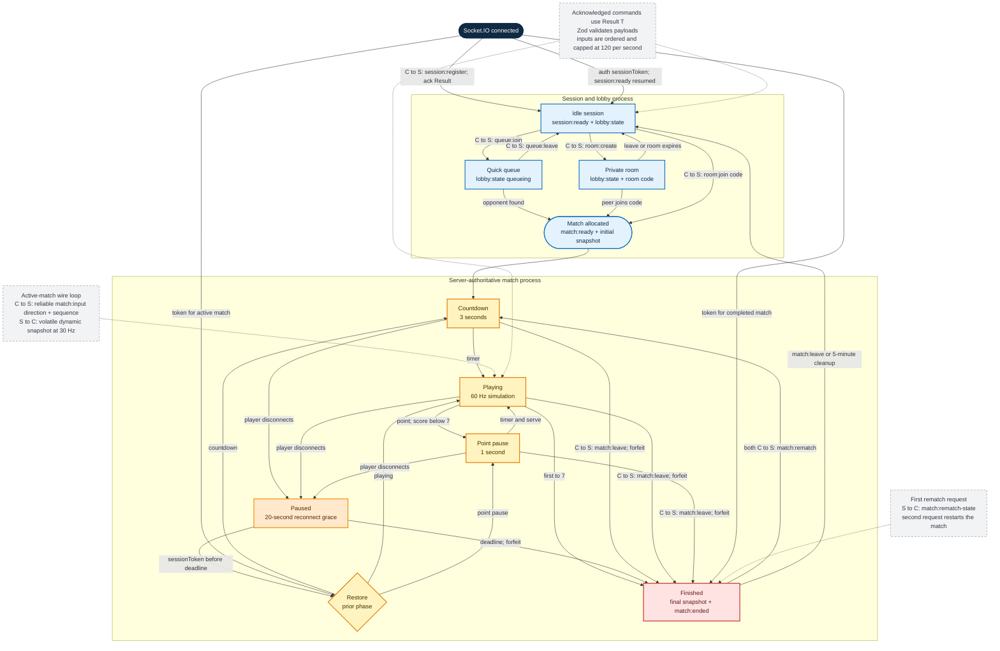

# Multiplayer protocol

This SDL-style state diagram describes the Socket.IO protocol implemented by
`src/shared/protocol.ts` and orchestrated by `src/server/multiplayer.ts`. The
server owns every lobby and match transition; clients send commands and render
the snapshots the server publishes.

`C->S` denotes a client-to-server event and `S->C` a server-to-client event.
Except for `match:input`, client commands use Socket.IO acknowledgements with
the shared `Result<T>` envelope. `server:error` is part of the declared shared
contract, while current command failures are returned through acknowledgements.

`match:ready` carries immutable player identity once. Repeated
`match:snapshot` payloads contain only dynamic simulation state and acknowledge
the latest processed input sequence for each player. Periodic snapshots are
volatile because a newer full state supersedes an older packet; initial,
reconnect, final, and rematch snapshots remain reliable.

The client renders remote state against the authoritative tick timeline with a
67–150 ms adaptive interpolation buffer. It may extrapolate for at most 50 ms.
The local paddle is predicted immediately and reconciled when its input
sequence appears in an authoritative snapshot.
